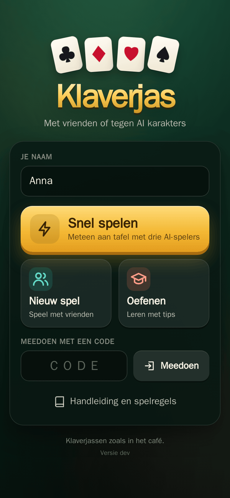
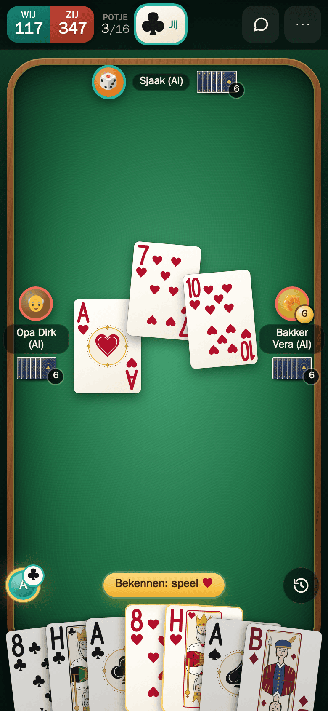
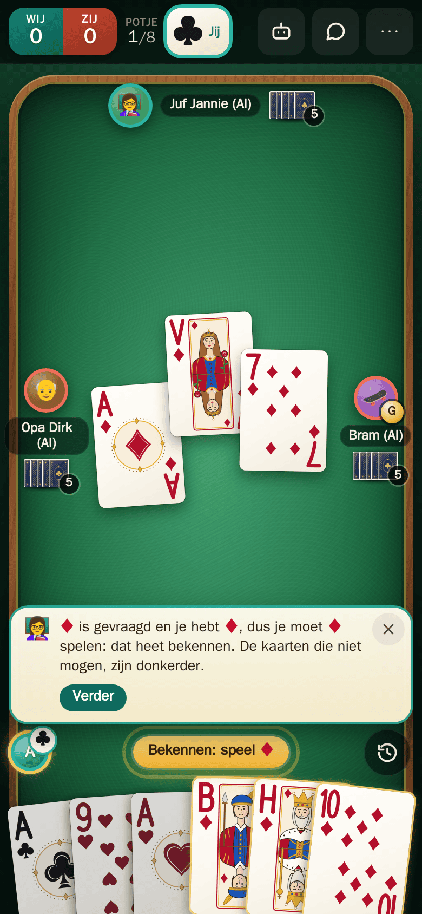
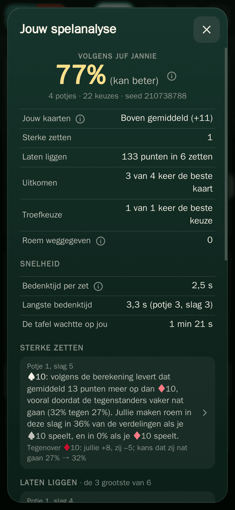
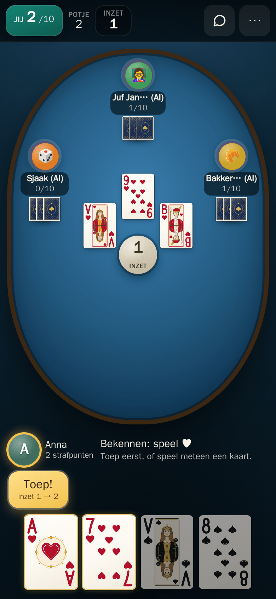
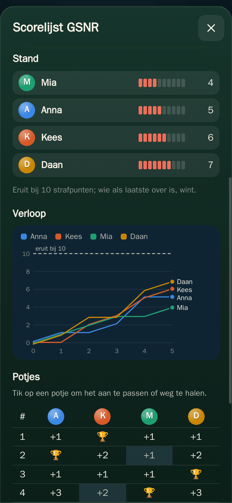
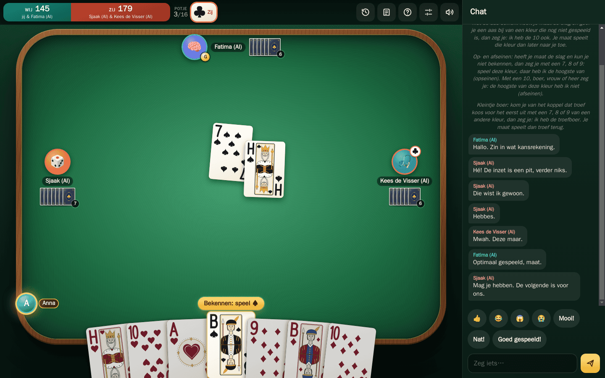

# Jannie

Dutch card games in the browser. Play with friends, against bots, or both,
with no account, no install and no ads. The interface is in Dutch.

Each game has a site of its own:

| Game | Site | Players |
|---|---|---|
| Klaverjas | <https://klaverjas.kroes.dev> | 2–4 |
| Toepen | <https://toepen.kroes.dev> | 2–6 |
| Bridge | planned | 4 |

## Klaverjas

The Dutch trick-taking game, with the rules as played in cafés.

- **Two, three or four players.** With four you play in pairs. With three,
  an auction decides who plays alone against the other two. With two, each
  player plays from piles on the table.
- **The usual rule sets**: *Utrechts* (voorhand chooses trump) or *gedraaid*
  (a turned suit to play or pass), and *Amsterdams* or *Rotterdams* trumping,
  with roem, nat and pit, over a *boom* of 16 hands or another length.
- **Bots with a character of their own**, from Opa Dirk to Bakker Vera, at
  three strengths. The strongest counts cards and plays each choice out in
  sampled deals.
- **Signals** (*seinen*), agreed per table: *met de aas seinen*, *op- en
  afseinen*, *kleintje boer* and *boer over boer*. Where the table agreed on
  them, bots at *normaal* and *sterk* give and read *met de aas seinen*,
  *opseinen* and *kleintje boer*, and read *boer over boer*; no bot gives
  or reads *afseinen*, and *makkelijk* bots play without signals.
- **Oefenen**: lessons with Juf Jannie as your partner (*Basisspel*, *Roem en
  tellen*, *Seinen*), taught step by step, with a hint on every turn and a
  tip after every trick.
- **Spelanalyse** after a game of four: a percentage for your own choices,
  judged from what you knew at the time, with the moves that gained or lost
  the most. Any hand can be replayed card by card.
- **Handleiding**: the controls, the rules, roem, signals, tips and a
  glossary.

| Home | At the table | Oefenen | Spelanalyse |
|:---:|:---:|:---:|:---:|
|  |  |  |  |

## Toepen

The game of raising the stake and bluffing: whoever takes the last trick wins
the round.

- **Two to six players**, each for themselves. Whoever reaches the limit of
  penalty points (*strafpunten*) is out, and the last player left wins.
- **House rules as options**: *Eruit bij* 10 or 15, *Vuile was* (and
  whether a caught bluffer plays the round with open cards or sits it out),
  *Armoede*, *Koningsspel*, *Boer* and *Anti-lijntoep*.
- **Bots at three strengths.** They bluff now and then, and the stronger
  two remember who bluffs at the table.
- **Score bijhouden**, for a game at a real table with real cards: one
  phone keeps the score, and everyone else follows it live with the code.

| At the table | Score bijhouden |
|:---:|:---:|
|  |  |

## Every game

- **Start in one tap**: *Snel spelen* seats you at a table with bots at
  once, without asking for a name.
- **Join with a code or a link**: *Nieuw spel* gives a four-letter code and
  a link. Friends type the code under *Meedoen* or open the link.
- **Calls** with sound and, if you like, video, from browser to browser.
- **No AI takes a seat unasked.** When a player leaves or loses the
  connection, the game waits. A bot stands in only when everyone else at
  the table agrees, and a friend with the code can take the seat.
- **Built for phones** (touch, portrait and landscape), and it works on
  tablets and desktop browsers with mouse and keyboard.



## Privacy

Each game's server keeps a log of every game, with the players' names, IP
addresses and browser (User-Agent), for at most 12 months. It is used for
statistics and to improve the games. Toepen's score sheets are deleted seven
days after their last change.

Calls go from browser to browser, not through the server, so the others in
a call see your IP address. Each browser learns its own address from two
public STUN servers, Google's and Cloudflare's, which see it too.

## Development

### Layout

```
platform/        the shared table and web shell
  server/        rooms, seats, lobby, chat, calls, takeover, game log, pacing, limits
                 (klaverjas is still built in here)
  serve/         what every game's binary shares: flags, HTTP server, dev static handler
  persona/       the bots' names and characters
  cards/         the seats and the 32-card deck the games share
  web/           the shell every game's site is built on (js/, css/)
games/<game>/    everything of one game: its Go packages, its site (web/), its settings
                 (<game>.mk) and a README with its design
cmd/<game>/      each game's server binary
deploy/          the container unit templates and the nginx configuration
docs/            the platform's design
test/            JS unit tests, full games over the websocket (e2e/), browser checks (ui/)
scripts/         the Go toolchain in a container, the dev server, headless Chromium, checks
```

The servers are Go, with one dependency. The sites are plain ES modules and
CSS, with no build step and nothing loaded from other sites.

### Quick start

The servers need podman, make and curl: the Go toolchain runs in a
container (`scripts/go`). The tests need Node 22.15 or later as well.

```sh
make dev GAME=klaverjas   # klaverjas from source on http://127.0.0.1:18093/
make dev GAME=toepen      # toepen on http://127.0.0.1:18095/
make test                 # go vet, the Go and JS tests, the deployment files
make help                 # the other targets
```

The first start compiles for about a minute, and Ctrl-C stops it.

### Documentation

- [docs/architecture.md](docs/architecture.md): how the platform and the
  games fit together
- [docs/server.md](docs/server.md): the table on the server, and the Go API
  a game implements
- [docs/protocol.md](docs/protocol.md): the websocket protocol
- [docs/frontend.md](docs/frontend.md): the web shell and a game's site
- [docs/deployment.md](docs/deployment.md): images, units and running a site
- [docs/adding-a-game.md](docs/adding-a-game.md): what a new game needs
- [games/klaverjas/README.md](games/klaverjas/README.md): klaverjas's rules
  as implemented, bots, lessons and Spelanalyse
- [games/toepen/README.md](games/toepen/README.md): toepen's rules, bots and
  Score bijhouden
- [CLAUDE.md](CLAUDE.md): commands, conventions and constraints in detail

### Contributing

Code, comments and docs are in English; every string a player sees is in
Dutch. The docs describe how the code works, so a change updates them in the
same commit. `make test` must pass.
